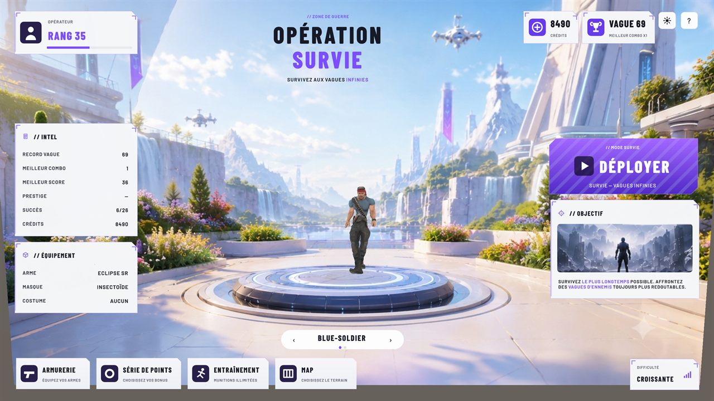
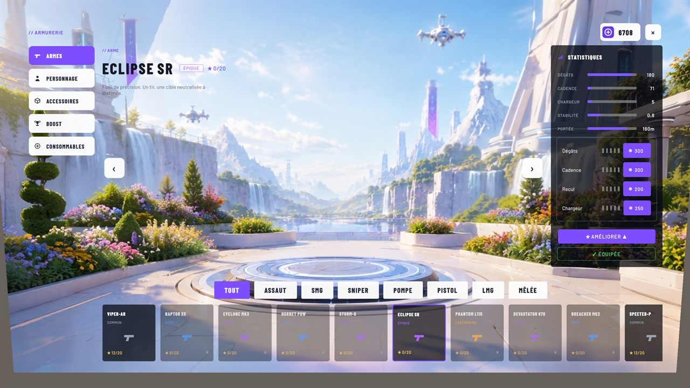
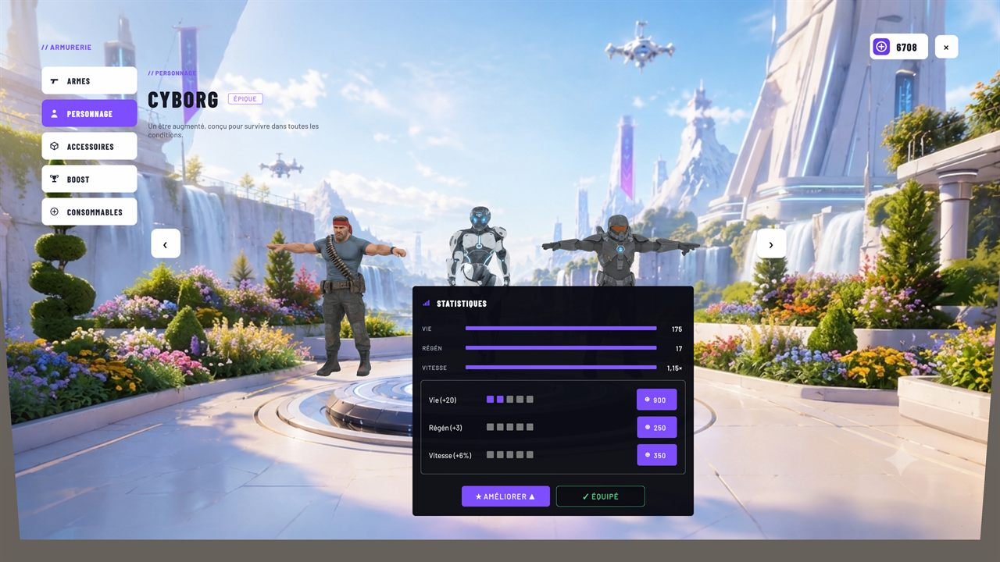
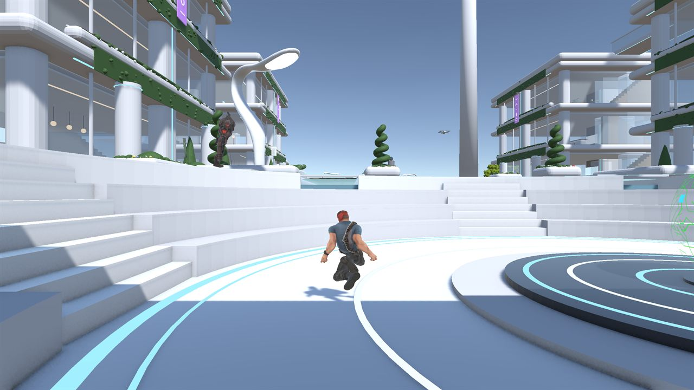

<div align="center">


# FPS

**A mobile wave-survival shooter built with Unity, set in a sunlit utopian city.**

Pick an operator, kit them out in the armory, then hold the line against endless waves of enemies that get smarter, tougher and stranger every round. Made for Android and iOS, fully playable with mouse and keyboard in the editor.

[Features](#features) · [Controls](#controls) · [Tech stack](#tech-stack) · [Getting started](#getting-started) · [Built with AI](#built-with-ai-assistance) · [Roadmap](#roadmap)


[](LICENSE)

</div>

<p align="center">
  
  
  
  
</p>

> **Status: in development.** The full solo experience is playable (waves, armory, progression, HUD, Utopia map). Online co-op and PvP come next. The interface is in French.

## Features

### Combat

- **Endless survival waves** that scale in size, health and composition, with a **boss every 5 waves** and golden VIP enemies worth double money.
- **16 enemy types** with their own behaviour: rushers, snipers, shielders that block frontal fire, bombers that explode on contact, medics that heal allies, grenadiers, ghosts, berserkers, commanders boosting nearby allies, and more.
- **Hit zones**: headshots, torso and limb multipliers, and two kinds of enemy armour.
- **15 weapons** across 7 classes (assault, SMG, sniper, shotgun, pistol, LMG, melee), with auto, burst and semi-auto fire modes, aim-down-sights and a full-screen sniper scope.
- **Throwables**: grenades with an aiming arc, flashbangs, smoke, sticky grenades, molotovs and EMPs, plus medkits.
- **24 power-ups** dropped by enemies, and **killstreak rewards**: proximity mine, turret, airstrike, care package and a war dog that fights at your side.
- **Movement**: sprint, jump, dash, melee, fall damage, and a first-person / third-person camera toggle.
- **Auto-fire on mobile** when the crosshair is on an enemy, with virtual joysticks and touch buttons. Manual fire and aiming stay available on keyboard.

### Meta and progression

- **Armory** with five tabs: weapons, operators, accessories (masks and costumes), boosts and consumables, each with rarity tiers.
- **Per-stat upgrades** for every weapon (damage, fire rate, recoil, magazine) and every operator (health, regeneration, speed).
- **XP and ranks** up to level 50, prestige, **26 achievements**, **daily contracts** and a local leaderboard.
- **Combo multiplier**, kill bonuses and an end-of-run report with a letter grade.
- **Difficulty levels**, hardcore and training modes, and in-game settings (sensitivity, volume, camera view).
- **Local save** that persists between sessions, with automatic migrations between versions.

## Controls

The game plays with touch controls on mobile. In the editor, the keyboard layout is AZERTY-friendly:

| Key | Action |
| --- | --- |
| **Z Q S D** / arrows | Move |
| **Mouse** | Look around |
| **Left click** or **E** | Fire |
| **Right click** or **A** | Aim down sights |
| **Shift** or **R** | Sprint |
| **Space** | Jump |
| **C** | Dash |
| **F** | Reload |
| **X** | Melee |
| **G** | Pick up a weapon from a fallen enemy |
| **B** (hold) | Aim and throw a grenade |
| **N H J K O** | Flashbang, smoke, sticky grenade, molotov, EMP |
| **T** / **P** | Switch fire mode |
| **Y L U I 4** | Killstreaks: mine, turret, airstrike, care package, war dog |
| **V** | Toggle first / third person |
| **M** | Mute |
| **Esc** | Pause |

## Tech stack

| Area | Choice |
| --- | --- |
| Engine | Unity 6 (6000.5.2f1), C# |
| Rendering | Universal Render Pipeline (separate PC and mobile render assets) |
| UI | UI Toolkit for the menus and the armory, uGUI for the in-game HUD |
| Input | Input System (keyboard, mouse, gamepad and touch) |
| AI navigation | AI Navigation (baked NavMesh) |
| 3D assets | glTFast to import GLB models and animations at edit time |
| Data | ScriptableObjects generated from JSON, Newtonsoft JSON for the save file |
| Tests | Unity Test Framework (EditMode and PlayMode) |
| Multiplayer (planned) | Photon Fusion |

### Implementation notes

- **Data-driven gameplay**: every weapon, enemy, power-up, achievement and balancing value lives in JSON files (`unity-spec/`). The menu **Tools → Game → Import Spec from JSON** turns them into about 90 ScriptableObjects referenced by a single `GameDatabase` asset. Changing the balance never requires touching code.
- **Assets are optional**: each data entry can point to a model or an icon, but no logic depends on it. A missing model falls back to a placeholder, so new art can be dropped in at any time.
- **Pure rules, thin MonoBehaviours**: wave formulas, economy, damage, XP, shop and save migrations are plain C# classes (`Scripts/Data/Rules`), covered by fast EditMode tests. MonoBehaviours only wire them to the scene.
- **Scenes are generated**: the Home, Slice and Utopia scenes can be rebuilt from scratch with editor menus (**Tools → Game → Build ... Scene**), so they stay reproducible and diff-friendly.
- **Separate assemblies** (`Game.Data`, `Game.Runtime`, their editor and test assemblies) keep data, gameplay and tooling decoupled and compile times short.
- **Animation without Animator Controllers**: a small Playables-based driver handles locomotion, attacks, death and crossfades in code.
- **Asynchronous map loading** with a real progress bar.

## Getting started

### Requirements

- [Unity Hub](https://unity.com/download) with **Unity 6000.5.2f1** (other Unity 6 versions may work but are not tested).
- [Git](https://git-scm.com/), which Unity also needs to fetch one package referenced by URL.
- About 3 GB of free disk space for the project and the Unity cache.

### Run the game

```bash
git clone https://github.com/Nathan-Part/FPS.git
```

1. Open **Unity Hub → Add → Add project from disk** and select the cloned folder.
2. Open the project. The first import takes several minutes while Unity builds its `Library/` cache.
3. In the **Project** window, open `Assets/_Game/Scenes/Home.unity`.
4. Press **Play**. From the home screen you can visit the armory, pick a map and press **Déployer** to start a run.

To test the gameplay without the menus, open `Assets/_Game/Scenes/Slice.unity` instead.

### Useful editor menus

| Menu | Description |
| --- | --- |
| **Tools → Game → Import Spec from JSON** | Regenerate all gameplay data from `unity-spec/*.json` |
| **Tools → Game → Build Home Scene** | Rebuild the home screen scene |
| **Tools → Game → Build Utopia Scene** | Rebuild the Utopia map scene and its NavMesh |
| **Tools → Game → Build Slice Scene** | Rebuild the gameplay test scene |
| **Tools → Game → Assign Imported Art** | Link imported models and animations to their data entries |

### Run the tests

Open **Window → General → Test Runner**, then run the **EditMode** tab (rules, economy, save, waves) and the **PlayMode** tab (scene smoke tests).

### Build for mobile

Install the **Android Build Support** or **iOS Build Support** module from Unity Hub, then use **File → Build Profiles**. `Home.unity` is already the first scene in the build list.

## Project structure

```
Assets/_Game/
├── Data/                 # Generated ScriptableObjects (weapons, enemies, items, power-ups...)
├── Art/                  # Characters, enemy, weapon, map (GLB), animations, UI images and fonts
├── Scenes/               # Home (menus), Utopia (map), Slice (gameplay test scene)
├── UI/                   # UI Toolkit documents and style sheets
├── Scripts/
│   ├── Data/             # Data types, pure gameplay rules and the save system
│   ├── Net/              # Online co-op core: host-authoritative session, transport, Photon adapter
│   ├── Runtime/
│   │   ├── Player/       # Movement, look, health, aiming
│   │   ├── Combat/       # Weapons, hit zones, throwables, power-ups, killstreaks
│   │   ├── Enemies/      # AI brain, specials, spawner, animation
│   │   ├── Waves/        # Wave composition and manager
│   │   ├── Loadout/      # Turret, airstrike, mines, care package, war dog
│   │   ├── HUD/          # In-game HUD, game over and pause screens
│   │   ├── Home/         # Home screen and armory controllers
│   │   └── ...           # Animation, audio, core, meta
│   └── Editor/           # JSON importer and scene builders
└── Tests/                # EditMode, runtime and PlayMode tests
unity-spec/               # Gameplay data in JSON, the source of truth for balancing
docs/                     # Roadmap, UI references and screenshots
```

## Built with AI assistance

This game was built with [Claude Code](https://claude.com/claude-code) working directly inside the Unity Editor through the [MCP for Unity](https://github.com/CoplayDev/unity-mcp) bridge (the `com.coplaydev.unity-mcp` package in `Packages/manifest.json`). Through this bridge Claude created and edited scripts, scenes and assets, ran the EditMode and PlayMode tests, read the editor console and took in-editor screenshots to check the result visually.

Game design, art direction, the Utopia map and playtesting are by Nathan-Part.

You don't need the MCP bridge to open, play or modify the project. Unity downloads the package automatically from GitHub when the project opens, which is why Git must be installed.

## Roadmap

- [x] Data import pipeline and playable solo prototype
- [x] Animated enemies and player, weapon in hand, first and third person
- [x] Full solo meta: save, economy, progression, achievements, contracts, killstreaks
- [x] Home screen and armory
- [x] Utopia map
- [ ] Cleaner map colliders and baked lighting
- [ ] More enemy models and a second map
- [x] Online co-op netcode core (host-authoritative simulation, transport-agnostic, tested)
- [ ] Playable online co-op against waves (scene binding + Photon Fusion)
- [ ] Team deathmatch PvP
- [ ] Release on Google Play and the App Store

The detailed plan, in French, is in [`docs/ROADMAP.md`](docs/ROADMAP.md).

## License

The source code is released under the [MIT License](LICENSE) © Nathan-Part.
The 3D models, animations, textures and fonts in `Assets/_Game/Art/` belong to their respective authors and are not covered by this license.
